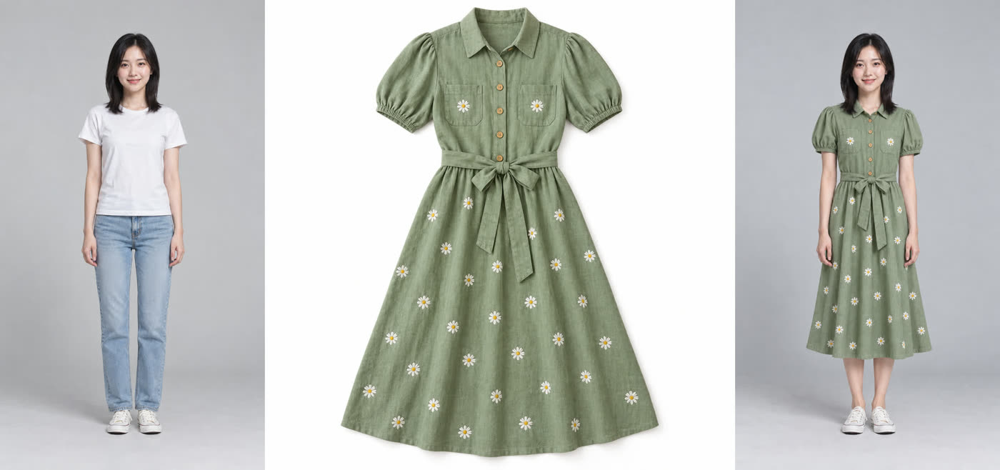
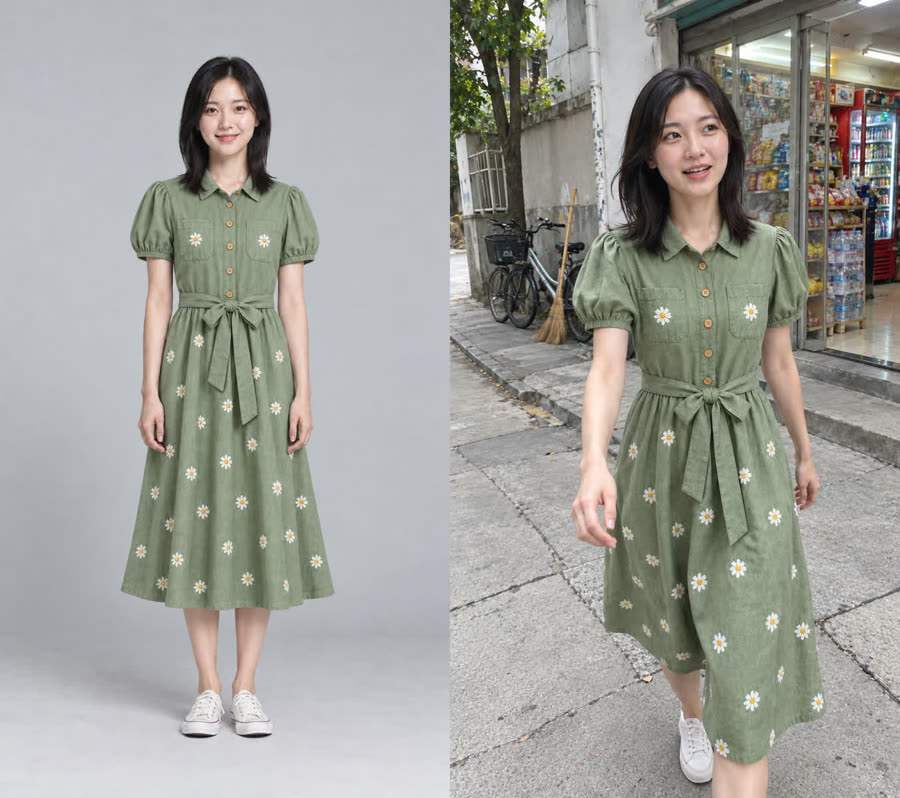

# tryon-vlog-skill

给 AI 编程助手（Claude Code / Codex CLI 等）用的 **AI 换装 vlog** skill：一张模特照 + 一张衣服照 → 模特换上这件衣服 → 一段 6 秒、像真人用手机拍的 vlog。

- 两种拍法：**自拍**（边走边拍）、**朋友跟拍**（朋友在前面倒退着拍，能拍到全身）
- 提示词由脚本按模板拼好，使用者只填一张表（`brief.json`），**能力弱一点的模型也能跑出接近的效果**：实测 Codex 的 gpt-6.1-sol（reasoning high）照着 SKILL.md 一次跑通
- 每一步都有审核图和「是 / 否」检查清单；花钱的一步必须显式加 `--spend`，并有防重复扣费保护

| 换装（左：模特，中：衣服，右：换装后） | 朋友跟拍首帧（左：换装照，右：首帧） |
|---|---|
|  |  |

视频抽帧（每 0.5 秒一格）：


> 示例里的人物和衣服都是 AI 生成的虚构形象。

## 流程

```
模特照 + 衣服照
  → ① 换装照        GPT Image（通过 Codex CLI，走 ChatGPT 套餐额度）
  → ② vlog 首帧     GPT Image：换场景、换机位，只继承人和衣服
  → ③ 6 秒视频      MiniMax H3 首帧生视频（按次付费）
  → ④ 成片          ffmpeg：放大到 1080×1920、去掉自动配音、加一层手机噪点
```

## 需要准备

| 东西 | 用来干什么 |
|---|---|
| Python 3.10+ | 跑脚本（只用标准库，不用 pip 装东西） |
| ffmpeg / ffprobe（在 PATH 里） | 拼审核图、出成片 |
| [Codex CLI](https://github.com/openai/codex)，已用 ChatGPT 账号登录 | 出图（用它自带的图片生成功能，不需要 OpenAI API key） |
| [MiniMax](https://platform.minimaxi.com) API key（有余额） | 出视频（MiniMax-H3，**每次生成都扣费**） |

## 安装

把这个仓库放进你的 agent 的 skill 文件夹，例如：

```bash
# Claude Code
git clone https://github.com/xmxiaocai88-rgb/tryon-vlog-skill ~/.claude/skills/tryon-vlog
# Codex CLI
git clone https://github.com/xmxiaocai88-rgb/tryon-vlog-skill ~/.codex/skills/tryon-vlog
```

然后建一个**工作文件夹**（放素材、密钥和输出），复制 `.env.example` 为 `.env` 填上 MiniMax 密钥：

```
MINIMAX_API_KEY=你的密钥
MINIMAX_HOST=https://api.minimaxi.com    # 国际站用 https://api.minimax.io
```

`.env` 只放在你自己的工作文件夹里，**不要提交到任何仓库**。

## 使用

在工作文件夹里打开 agent，说「做一条换装 vlog，模特照是 xxx，衣服照是 xxx」。agent 会按 `SKILL.md` 一步步做，在每个检查点给你看审核图；花钱前会先问你。

也可以手动跑（在工作文件夹下）：

```bash
python -I <skill目录>/scripts/tryon_vlog.py init 绿色连衣裙      # 新建 output/换装vlog/日期-绿色连衣裙/
# 编辑里面的 brief.json
python -I <skill目录>/scripts/tryon_vlog.py lint  "<作品文件夹>"
python -I <skill目录>/scripts/tryon_vlog.py tryon "<作品文件夹>"   # 之后复制它打印的 pick 命令
python -I <skill目录>/scripts/tryon_vlog.py frame "<作品文件夹>"   # 同上
python -I <skill目录>/scripts/tryon_vlog.py video "<作品文件夹>" --spend
```

工作文件夹默认是运行命令时所在的文件夹，也可以用环境变量 `TRYON_VLOG_WORKDIR` 指定。

## 为什么这样写（实测得出的经验）

- **AI 味来自「完美」**：点名具体器材（iPhone 前置 / 后置主摄），写清手机的毛病（手抖、过曝、构图歪、头顶被切掉一点），显式关掉电影感、美颜、磨皮。手持真实感和电影级打光不能写在同一条提示词里。
- **身份锁定靠「继承 + 不继承」**：参考图只继承人和衣服，背景、姿势、构图、光线一律不继承；衣服拆成单品逐条写。
- **一段只做一个动作**：6 秒分两段时间轴，动作塞多了每个都只做一半。
- **皮肤写「哑光」，别写「出油的光泽」**：后者在阴天平光下会被视频模型放大成一层油光；后期也不要锐化。
- **视频模型会自己美颜**：首帧再真实，H3 也会把脸磨光一点，成片加一层噪点能缓解一些。
- **brief 用 lint 把关**：禁用会把画面拉回精修感的词（电影、柔光、逆光、景深、完美、精致……），限制动作长度和数量，检查动作和拍法是否匹配。

提示词结构参考了 [LearnPrompt/awesome-seedance](https://github.com/LearnPrompt/awesome-seedance)（MIT）里「手持 UGC vlog」「参考图身份锁定」「逐秒时间轴分镜」「时尚 lookbook」几个模板总结的经验，并在 GPT Image + MiniMax H3 上重新实测、改写。

## 已知限制

- 视频不会说话（MiniMax 自动配的声音会被去掉）；要口播需要另外的配音和对口型工具。
- H3 偶尔会自己推近镜头、动作比时间轴晚 1 秒左右开始。
- 换装后图案（印花、刺绣）的密度和大小可能和商品图有出入，用于真实带货时要人工核对。
- 在 Codex CLI 里运行时，外层沙箱可能导致内层出图失败，见 SKILL.md 末尾。
- 用真人照片做模特，必须先取得本人同意。

## License

MIT
